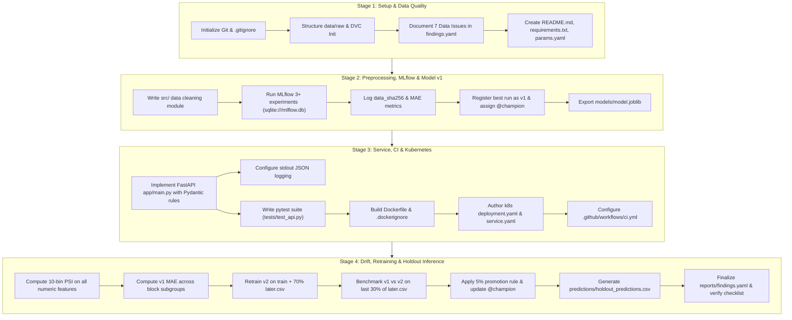

# PART 01 — Project Inspection and Planning Report

**Project:** MP217 — Ration Shop Distribution (Kochi)  
**Group:** G230  
**Batch:** 33  
**Faculty:** Upasna Joshi  
**Course:** SCSE3040 MLOps  
**Timestamp of Inspection:** 2026-11-23T23:35:00+05:30  
**Status:** PASS — Inspection completed successfully  

---

## 1. Project Overview

### 1.1 Client & Business Problem
* **Client:** Kochi Food and Civil Supplies Office (Kerala, India).
* **Operational Context:** Fair price (ration) shops across development blocks in Kochi distribute essential food grains to card-holding families. Because of erratic demand, stockouts frequently occur by midday at several shops, forcing families to return empty-handed.
* **Objective:** Build an end-to-end production-grade machine learning system to forecast daily grain distribution demand (`grain_kg`) per ration shop in advance, enabling the Civil Supplies Office to dispatch replenishment stock proactively.
* **ML Task Formulation:** Tabular supervised regression.
* **Primary Evaluation Metric:** Mean Absolute Error (MAE) in kilograms ($\text{kg}$), measuring the average absolute deviation between predicted and actual grain handed out per shop-day.

### 1.2 Group Membership & Assigned Roles
* **Group ID:** G230
* **Group Members (from `GROUP.md`):**
  * S24CSEU1502 — Palak Verma
  * S24CSEU1486 — Naresh Yadav
  * S24CSEU1472 — Amandeep singh
  * S24CSEU1500 — Anurag Singh
  * S24CSEU1481 — Paarth Kashiv
* **Functional Roles (as per Student Handbook guidance):**
  * **Data Lead:** DVC initialization, original dataset fingerprinting, empirical audit of the 7 data-quality issues, data cleaning modules, and completing the data issues portion of `findings.yaml`.
  * **Model Lead:** Feature engineering pipeline, baseline and candidate model training, experiment tracking with SQLite MLflow, model registry, versioning (v1, v2), and holdout predictions.
  * **Service Lead:** FastAPI prediction service (`POST /predict`, `GET /health`), Pydantic validation rules, structured JSON logging to stdout, Docker containerization, and unit/integration testing with `pytest` / `TestClient`.
  * **Ops Lead:** GitHub Actions CI workflow, Kubernetes manifests (`deployment.yaml`, `service.yaml`), PSI drift calculation, sliced subgroup evaluation, retraining logic, and champion promotion.

---

## 2. Complete Understanding of Requirements

### 2.1 Four-Stage Project Lifecycle
According to `STUDENT_HANDBOOK.md` (Section 6), the project must be executed across four distinct stages:
1. **Stage 1 (Data & Setup):** Initialize Git and DVC, secure original data fingerprints in `.dvc` tracking files, investigate the 7 data problems in `train.csv`, record empirical observations in `findings.yaml`, and create `README.md`.
2. **Stage 2 (Cleaning & Model v1):** Develop modular cleaning and preprocessing routines in `src/`, run $\ge 3$ distinct model configurations tracked in SQLite `mlflow.db`, log original `train.csv` SHA-256 hash and MAE metrics, register the best model as `v1`, assign the `@champion` alias, and construct unit tests.
3. **Stage 3 (Deployment & CI):** Build the FastAPI application with client business rules enforced in Pydantic schema (returning HTTP 422 on violations), implement stdout JSON logging, author the Dockerfile and `.dockerignore`, configure Kubernetes deployment and service manifests, and set up a green GitHub Actions CI pipeline.
4. **Stage 4 (Monitoring, Retraining & Final Prediction):** Ingest `later.csv`, compute 10-bin Population Stability Index (PSI) across all numerical features, analyze performance degradation across geographical slices (`block`), retrain model `v2` on combined historical and early-window data (first 70% of `later.csv`), apply the client's 5% MAE improvement promotion threshold, predict the unlabelled `holdout_features.csv`, and finalize `findings.yaml`.

### 2.2 Client-Specified Service & Deployment Rules
* **API Endpoints:**
  * `POST /predict`: Input payload must strictly accept the 8 operational features: `cards_attached`, `working_hours`, `biometric_failures`, `temp_c`, `stock_kg_morning`, `days_to_month_end`, `shop_area`, `block`. (Neither `record_id` nor `date` may be required in this payload).
  * `GET /health`: Must respond with HTTP 200 and JSON payload `{"status": "ok"}` (additional diagnostic metadata is permissible).
* **Pydantic Validation Guardrails (`PROBLEM.md` Section 5):**
  1. `biometric_failures > 150` is physically impossible for the shop hardware; must be rejected with HTTP 422. Enforce via `Field(..., le=150)`.
  2. `working_hours < 1.5` is considered a data-entry error; must be rejected with HTTP 422. Enforce via `Field(..., ge=1.5)`.
* **Logging Requirements:** Python standard library `logging` configured with a JSON formatter printing exactly one structured JSON line per prediction to standard output (`stdout`), containing no sensitive personally identifiable information.
* **Containerization Specifications (`PROBLEM.md` Section 6):**
  * Base Image: `python:3.12-slim`
  * Image Tag: `mp217-api:1.0`
  * Build Pattern: Copy `requirements.txt` and execute `pip install` before copying source code (optimizing Docker layer caching).
  * Network: `EXPOSE 8000`, run `uvicorn` bound to `0.0.0.0:8000`.
* **Kubernetes Specifications (`PROBLEM.md` Section 6):**
  * Deployment Name: `mp217-api`
  * Service Name: `mp217-svc`
  * Replica Count: Exactly **4**
  * Ports: Container port `8000`, Service port `80` routing to target port `8000`.
  * Health Probes: Both `readinessProbe` and `livenessProbe` configured on `httpGet` path `/health`. Liveness probe must have a longer initial delay / waiting threshold than readiness probe (`initialDelaySeconds`).
  * Selectors: Service label selector must strictly match Deployment pod template labels (`app: mp217-api`).

### 2.3 MLflow & Experiment Tracking Rules
* **Tracking Backend:** Must utilize local SQLite backend at repository root: `sqlite:///mlflow.db`. Local folder `./mlruns` is rejected by MLflow 3. The `mlflow.db` file must be tracked and committed in Git.
* **Mandatory Run Parameters & Metrics:**
  * Parameter `data_sha256`: SHA-256 hash of original uncleaned `data/raw/train.csv` computed on binary bytes.
  * Metric: A test/validation regression error containing `mae` (e.g., `mae_val`, `mae_later`).
* **Registry & Versioning:**
  * Minimum 3 logged runs.
  * Model registered under a defined model name.
  * Model `v1` registered from initial training.
  * Retrained model registered as version `v2`.
  * Alias `@champion` assigned to the winning model version.
  * Serialization format: Use `serialization_format="cloudpickle"` if MLflow 3 raises untrusted type warnings.

### 2.4 Drift Monitoring, Retraining & Holdout Inference
* **Population Stability Index (PSI):**
  * Compute 10-bin PSI for all 6 numeric input features between cleaned `train.csv` (reference baseline) and `later.csv` (production monitoring window).
  * Features evaluated: `cards_attached`, `working_hours`, `biometric_failures`, `temp_c`, `stock_kg_morning`, `days_to_month_end`.
  * Determine and document `most_drifted_feature`.
* **Subgroup Performance Slicing:**
  * Evaluate model `v1` MAE on `later.csv` segmented by `block`: `'Block North'`, `'Block South'`, `'Block East'`.
  * Identify `worst_served_group`.
* **Retraining & Promotion Rule:**
  * Sort `later.csv` chronologically by `date`.
  * Partition `later.csv` temporally: first 70% (210 rows) for retraining, final 30% (90 rows) as evaluation holdout.
  * Train model `v2` on cleaned `train.csv` + first 70% of `later.csv`.
  * Benchmark `v1` vs `v2` on the last 30% of `later.csv`.
  * **Client Promotion Condition:** Promote `v2` to `@champion` if and only if $\text{MAE}_{v2} \le 0.95 \times \text{MAE}_{v1}$ (at least a 5% error reduction). Otherwise, maintain `v1` as champion.
* **Final Holdout Prediction:**
  * Score all 250 unlabelled rows of `data/raw/holdout_features.csv` using the `@champion` model.
  * Generate `predictions/holdout_predictions.csv` with exactly two columns: `record_id,prediction`.

---

## 3. Dataset Shapes and Column Descriptions

All statistics, shapes, checksums, and date ranges below have been empirically computed and verified directly from the dataset files in `G230_MP217/data/`.

### 3.1 Dataset Summary Table

| Dataset | File Path | Rows | Columns | Date Range | SHA-256 Checksum | Missing Values | Target Present |
|---|---|---|---|---|---|---|---|
| **Training** | `data/train.csv` | 1,027 | 11 | 2026-01-01 to 2026-06-30 | `d65889d074586614eaddcb806298ccd08f60c4555c3ad8709842f67dffec0d6a` | 0 | Yes (`grain_kg`) |
| **Production Monitor** | `data/later.csv` | 300 | 11 | 2026-07-01 to 2026-08-31 | `966d0c8e759b263250febeaa45b365b28470d2047bb7e6417a21921f40603d59` | 0 | Yes (`grain_kg`) |
| **Unlabelled Holdout** | `data/holdout_features.csv` | 250 | 10 | 2026-09-01 to 2026-09-30 | `aa6d44b46bb337d52b6cfc3102f2d7dc3f94fddabad4171c2b3af36e964d1310` | 0 | No |

### 3.2 Column Dictionary and Schema Specification

| Column Name | Inferred Dtype | Unit | Type / Role | Description | Observed Range / Levels | API Schema Requirement |
|---|---|---|---|---|---|---|
| `record_id` | `object` (str) | Text | Metadata / ID | Unique identifier for the daily shop transaction (e.g. `R00001` to `R50250`). | Non-null unique IDs per record. | Omit from `/predict` payload. |
| `date` | `object` (str) | YYYY-MM-DD | Temporal Feature | Transaction date. Monotonically increasing across files. | 2026-01-01 to 2026-09-30. | Omit from `/predict` payload. |
| `cards_attached` | `int64` | Count | Numerical Input | Number of active ration cards registered to the fair price shop. | Train: [202, 1997]; Later: [200, 1999]; Holdout: [201, 1995]. | Required input in `/predict`. |
| `working_hours` | `float64` | Hours | Numerical Input | Number of operational hours the shop remained open during the day. | Train: [3.0, 10.0]; Later: [3.0, 10.0]; Holdout: [3.1, 10.0]. | Required; reject if `< 1.5` (422). |
| `biometric_failures` | `int64` | Count | Numerical Input | Number of failed biometric authentication attempts at the point of sale. | Train: [0, 80]; Later: [38, 118]; Holdout: [38, 118]. | Required; reject if `> 150` (422). |
| `temp_c` | `float64` | °C | Numerical Input | Ambient maximum daily temperature recorded in Celsius. | Train: [5.0, 46.0]; Later: [6.1, 46.0]; Holdout: [5.1, 46.0]. | Required input in `/predict`. |
| `stock_kg_morning` | `float64` / `int64` | kg | Numerical Input | Available grain stock in kilograms at the opening of the shop. | Train: [207.0, 2,997,000.0]; Later: [208, 2993]; Holdout: [208, 2989]. | Required input in `/predict`. |
| `days_to_month_end` | `int64` | Days | Numerical Input | Remaining days until the conclusion of the calendar distribution month. | Train: [0, 30]; Later: [0, 30]; Holdout: [0, 29]. | Required input in `/predict`. |
| `shop_area` | `object` (str) | Category | Categorical Input | Geographical classification of the shop: `tribal`, `rural`, or `urban`. | Train has 17 spelling variants; Later/Holdout have 3 clean levels. | Required input in `/predict`. |
| `block` | `object` (str) | Category | Categorical Input | Administrative development block: `Block North`, `Block South`, `Block East`. | 3 consistent levels across all datasets. | Required input in `/predict`. |
| `grain_kg` | `float64` | kg | **Target (Regression)** | Total grain distributed during the day in kilograms. | Train: [145.0, 14,858.0]; Later: [0.0, 1981.9]. | **Prediction Target**. |

---

## 4. Empirical Audit of the Seven Data-Quality Problems

An exhaustive computational inspection of `data/train.csv` was conducted against the criteria outlined in `STUDENT_HANDBOOK.md` (Section 7) and `PROBLEM.md` (Section 4).

### 4.1 Summary of Findings

| Problem Kind | Status | Empirical Finding / Details | Action Required in Cleaning Pipeline |
|---|---|---|---|
| **1. `leaking_column`** | **Absent (`false`)** | No target leakage column exists. All 10 feature columns in `train.csv` correspond exactly to the columns provided in `holdout_features.csv`. | None. |
| **2. `unit_mixup`** | **Present (`true`)** | In `Block East`, `stock_kg_morning` was recorded in grams instead of kilograms (mean: 1,412,883; min: 206,000; max: 2,997,000). Exactly a **factor of 1000**. `Block North` and `Block South` are in standard kg (~200 to 3000 kg). | For rows where `block == 'Block East'`, divide `stock_kg_morning` by `1000.0`. |
| **3. `sentinel_value`** | **Absent (`false`)** | No sentinel indicators (e.g. `-1`, `-999`, `9999`) or unnatural spikes detected across any numeric column. | None. |
| **4. `duplicate_rows`** | **Present (`true`)** | Exactly **27 extra copies** (`train.duplicated().sum() == 27`). Total rows: 1,027; unique records: 1,000. | Apply `df.drop_duplicates()` to retain the 1,000 unique records. |
| **5. `stuck_sensor`** | **Absent (`false`)** | No long chronological runs of frozen identical values across consecutive dates. Daily variance is normal. | None. |
| **6. `target_typos`** | **Present (`true`)** | Exactly **9 rows** have `grain_kg` inflated by an extra zero (**10 times too big**). Max values range from 6,891.0 to 14,858.0, with a large void between 1,864.0 and 6,891.0. Dividing by 10 restores them to standard distribution [689.1, 1485.8]. | For the 9 affected rows (or where `grain_kg > 2000.0`), divide `grain_kg` by `10.0`. |
| **7. `spelling_variants`** | **Present (`true`)** | Column `shop_area` contains 17 irregular representations of 3 true categories (e.g. `' tri.'`, `'Tribal'`, `'TRIBAL'`, `'rur.'`, `'urb.'`, with leading/trailing whitespaces). `true_levels = 3`. | Standardize `shop_area` string (strip whitespace, lowercase, canonical mapping to `tribal`, `rural`, `urban`). |

### 4.2 Mathematical & Empirical Verification of Data Problems
* **Unit Mixup Verification:**
  * In `train.csv`, `stock_kg_morning` statistics:
    * `Block North` ($N=673$): Mean = 1,588.68 kg, Min = 207 kg, Max = 2,999 kg.
    * `Block South` ($N=175$): Mean = 1,513.20 kg, Min = 231 kg, Max = 3,000 kg.
    * `Block East` ($N=179$): Mean = 1,412,883.00 g, Min = 206,000 g, Max = 2,997,000 g.
  * In `later.csv`, `Block East` is recorded in normal kg: Mean = 1,546.47 kg, Min = 208 kg, Max = 2,861 kg.
  * Conclusion: Exact conversion factor is **1000**.
* **Target Typos Verification:**
  * Distribution percentiles for `grain_kg`: 25% = 839.15, 50% = 1063.50, 75% = 1301.35, 99% = 1823.10.
  * The 9 outlier records are:
    * Index 20 (`R00019`): `grain_kg = 6891.0` (cards attached = 220, morning stock = 630 kg $\rightarrow$ actual is 689.1 kg)
    * Index 205 (`R00202`): `grain_kg = 14858.0` $\rightarrow$ 1485.8 kg
    * Index 210 (`R00207`): `grain_kg = 13450.0` $\rightarrow$ 1345.0 kg
    * Index 215 (`R00212`): `grain_kg = 12649.0` $\rightarrow$ 1264.9 kg
    * Index 272 (`R00268`): `grain_kg = 13137.0` $\rightarrow$ 1313.7 kg
    * Index 471 (`R00462`): `grain_kg = 11497.0` $\rightarrow$ 1149.7 kg
    * Index 642 (`R00632`): `grain_kg = 12462.0` $\rightarrow$ 1246.2 kg
    * Index 663 (`R00651`): `grain_kg = 11262.0` $\rightarrow$ 1126.2 kg
    * Index 745 (`R00731`): `grain_kg = 12286.0` $\rightarrow$ 1228.6 kg
  * None of these 9 rows are among the 27 duplicated rows.
* **Spelling Variants in `shop_area`:**
  * Raw unique values in `train.csv` (17): `'tribal'`, `' tribal'`, `'rural'`, `'tri.'`, `' urban'`, `'tribal '`, `'urban'`, `'Tribal'`, `'urb.'`, `' rural'`, `'rural '`, `'Rural'`, `'TRIBAL'`, `'Urban'`, `'rur.'`, `'URBAN'`, `'RURAL'`.
  * Target clean levels in `later.csv` (3): `'tribal'`, `'rural'`, `'urban'`.

---

## 5. Existing Repository Structure & Implementation Status

### 5.1 Existing Files vs Target Layout
Currently, the workspace `/Users/nareshyadav/Desktop/mlops_project` contains only the raw problem package in `G230_MP217/`:

```
/Users/nareshyadav/Desktop/mlops_project/
├── .DS_Store
└── G230_MP217/
    ├── GROUP.md
    ├── PROBLEM.md
    ├── STUDENT_HANDBOOK.md
    ├── findings.yaml
    └── data/
        ├── holdout_features.csv
        ├── later.csv
        └── train.csv
```

### 5.2 Target Repository Layout Required by Marking Tool
As specified in `STUDENT_HANDBOOK.md` (Section 5), the marking tool expects the root of the Git repository to have the following exact structure:

```
├── README.md                      # Group id, problem id, member enrolment numbers
├── requirements.txt               # All libraries pinned: e.g. pandas==2.2.3
├── params.yaml                    # Hyperparameters and path settings (yaml.safe_load)
├── src/
│   └── <package>/
│       ├── __init__.py
│       ├── data.py                # Data loading, cleaning, validation routines
│       ├── train.py               # MLflow training and registration
│       └── evaluate.py            # PSI drift, subgroup MAE, holdout scoring
├── tests/
│   └── test_api.py                # >= 3 pytest tests; TestClient test
├── data/
│   └── raw/
│       ├── train.csv.dvc          # DVC tracking pointer
│       ├── later.csv.dvc          # DVC tracking pointer
│       └── holdout_features.csv   # Features file
├── .dvc/                          # DVC internal metadata
│   └── config
├── mlflow.db                      # SQLite MLflow tracking database (committed)
├── app/
│   └── main.py                    # FastAPI service: POST /predict & GET /health
├── models/
│   └── model.joblib               # Serialized champion model
├── Dockerfile                     # python:3.12-slim container build
├── .dockerignore
├── .github/
│   └── workflows/
│       └── ci.yml                 # GitHub Actions running pytest on push
├── k8s/
│   ├── deployment.yaml            # mp217-api deployment (4 replicas)
│   └── service.yaml               # mp217-svc service (port 80 -> 8000)
├── reports/
│   ├── PART_01_REPORT.md          # Project inspection & planning report (this file)
│   └── findings.yaml              # Completed submission form
└── predictions/
    └── holdout_predictions.csv    # Generated final predictions (record_id,prediction)
```

### 5.3 Existing Implementation Status Audit

| Target Component | Status | Empirical Observation |
|---|---|---|
| Git Version Control | **Not initialized** | Workspace is an uninitialized local directory. |
| DVC Data Tracking | **Not initialized** | No `.dvc/` folder, no `.dvcignore`, no `.dvc` tracking files. |
| `findings.yaml` | **Unfilled Template** | All data issues, tracking fields, monitoring metrics, and decisions are currently `null`. |
| `README.md` | **Missing** | Not yet created. |
| `requirements.txt` | **Missing** | Not yet created. System environment has Python 3.11 with standard tools, but needs project dependencies pinned. |
| `params.yaml` | **Missing** | Not yet created. |
| `src/` Code Package | **Missing** | No Python modules implemented. |
| `tests/` Test Suite | **Missing** | No pytest test files implemented. |
| `mlflow.db` | **Missing** | No MLflow runs executed or logged to SQLite. |
| `app/main.py` | **Missing** | No FastAPI application written. |
| `Dockerfile` & `.dockerignore` | **Missing** | Container assets not authored. |
| `.github/workflows/ci.yml` | **Missing** | CI workflow absent. |
| `k8s/` Manifests | **Missing** | Deployment and Service YAML manifests absent. |
| `models/model.joblib` | **Missing** | Model has not been trained or exported. |
| `predictions/` Outputs | **Missing** | Holdout predictions have not been generated. |

---

## 6. All Missing Components

To achieve 100% compliance with the rubric, the following components must be built:

1. **Repository & Version Control Configuration:**
   * Git initialization and creation of `.gitignore` (ignoring `.DS_Store`, `venv/`, raw data CSVs, `mlruns/`, `mlartifacts/`).
   * Setup of root `README.md` containing Group ID (`G230`), Problem ID (`MP217`), Batch (`33`), and enrolment numbers for all 5 members.
   * `requirements.txt` with strict pinning (`fastapi==0.115.6`, `uvicorn==0.34.0`, `pydantic==2.10.4`, `scikit-learn==1.6.1`, `pandas==2.2.3`, `numpy==2.0.2`, `mlflow==2.20.1`, `joblib==1.4.2`, `pyyaml==6.0.2`, `pytest==8.3.4`, `httpx==0.28.1`, `dvc==3.59.0`).
   * `params.yaml` declaring paths, hyperparameter grids, drift thresholds, and client rules.

2. **DVC Pipeline:**
   * `dvc init` configuration.
   * Data directory structured under `data/raw/`.
   * Tracking `data/raw/train.csv.dvc` and `data/raw/later.csv.dvc` while keeping original CSVs untracked by Git.

3. **Core Modular Code (`src/`):**
   * Package structure: `src/ration_distribution/` with `__init__.py`.
   * `data.py`: Functions to load data, clean duplicate rows, fix `stock_kg_morning` in `Block East`, fix the 9 target typos in `grain_kg`, standardize `shop_area`, and extract features.
   * `train.py`: MLflow tracking to `sqlite:///mlflow.db`, hashing original `train.csv` SHA-256, training baseline and candidate regressors (e.g. Ridge, RandomForest, GradientBoosting), logging MAE metrics, registering model `v1`, and registering champion `v2`.
   * `monitor.py`: Vectorized 10-bin PSI calculator, group-wise MAE evaluator on `later.csv`, 70/30 time-split retraining logic, 5% improvement promotion gate, and holdout batch prediction generator.

4. **Testing Suite (`tests/`):**
   * Minimum 3 unit/integration tests using `pytest`.
   * `TestClient` integration test verifying `POST /predict` returns correct schema and predictions on synthetic payload.
   * Tests verifying `POST /predict` rejects `biometric_failures > 150` with status 422.
   * Tests verifying `POST /predict` rejects `working_hours < 1.5` with status 422.
   * Test verifying `GET /health` returns `{"status": "ok"}`.
   * Zero dependence on raw CSV files during test execution.

5. **FastAPI Serving Engine (`app/main.py`):**
   * Pydantic input model (`DistributionRequest`) with explicit `Field` bounds:
     * `biometric_failures: int = Field(..., le=150)`
     * `working_hours: float = Field(..., ge=1.5)`
     * Remaining 6 fields typed and validated.
   * Endpoint `POST /predict` loading `models/model.joblib`.
   * Endpoint `GET /health` returning `{"status": "ok"}`.
   * Standard library JSON structured logging to `sys.stdout` logging request timestamps, inputs (excluding sensitive attributes), prediction value, and latency.

6. **Containerization & Deployment Manifests:**
   * `Dockerfile`: `FROM python:3.12-slim`, copy requirements first, run pip install, copy application and model, expose port 8000, launch uvicorn.
   * `.dockerignore`: Exclude Git, DVC cache, tests, datasets, virtual environments.
   * `k8s/deployment.yaml`: Deployment name `mp217-api`, 4 replicas, container port 8000, readiness probe on `/health` (initialDelay 5s), liveness probe on `/health` (initialDelay 15s).
   * `k8s/service.yaml`: Service name `mp217-svc`, selector matching `app: mp217-api`, port 80 routing to targetPort 8000.

7. **CI/CD Automation:**
   * `.github/workflows/ci.yml`: Root key `on: [push, pull_request]`, Python 3.12 environment, dependency installation, running `pytest tests/`.

8. **Final Submission Artifacts:**
   * `reports/findings.yaml`: Fully populated YAML replacing all `null` values with verified figures.
   * `predictions/holdout_predictions.csv`: 250 predictions for `record_id` `R50001` through `R50250`.

---

## 7. Proposed Implementation Sequence

Following the guidelines of `STUDENT_HANDBOOK.md` and keeping all changes clean and verified:



---

## 8. Potential Risks, Pitfalls and Dependencies

| Risk / Pitfall | Impact | Mitigation Strategy |
|---|---|---|
| **Modifying Original CSV Files** | Tool marks data hash as invalid; scores 0. | Treat original CSVs as strictly read-only. Store untouched originals in `data/raw/` and perform all cleaning programmatically in Pandas pipelines. |
| **Excel Auto-Formatting** | Destroys timestamps and numbers; changes file SHA-256 hash. | Never inspect or save datasets in Microsoft Excel. Use Python CLI and standard pandas inspection tools. |
| **MLflow Local Directory Usage** | MLflow 3 fails on `./mlruns` tracking. | Strictly configure `mlflow.set_tracking_uri("sqlite:///mlflow.db")` and commit `mlflow.db` to Git. |
| **MLflow Model Serialization Failure** | "untrusted types" error during `log_model`. | Pass `serialization_format="cloudpickle"` inside `mlflow.sklearn.log_model()`. |
| **Pydantic Validation Bypass** | Client rules not enforced at schema level; invalid requests reach model. | Use Pydantic `Field(..., le=150)` and `Field(..., ge=1.5)` in the request model so FastAPI rejects invalid input with HTTP 422 automatically. |
| **CI Test Failure on GitHub Actions** | Raw data is in `.dvc` / `.gitignore`, causing tests to fail if they load CSV files. | Construct in-memory synthetic DataFrames / mock dictionaries within `tests/test_api.py`. Never read `data/raw/*.csv` inside tests. |
| **YAML Formatting in GitHub Actions** | Saving YAML via naive dump converts `on:` to `true:`, causing GitHub Actions syntax error. | Format `.github/workflows/ci.yml` with quotes or literal string `on: [push, pull_request]`. |
| **Kubernetes Probe Misconfiguration** | Pods enter CrashLoopBackOff or fail readiness check during automated grading. | Ensure both probes target `/health` on port 8000, with `livenessProbe` having `initialDelaySeconds` greater than `readinessProbe`. |
| **Time-Split Data Leakage** | Shuffling `later.csv` before splitting violates chronological holdout evaluation. | Sort `later.csv` monotonically by `date` before slicing the first 70% (rows 0 to 209) and final 30% (rows 210 to 299). |
| **Holdout Predictions Formatting** | Column names or row count mismatch causes 0 score on Section L. | Output strictly two columns: `record_id,prediction` with exactly 250 rows matching `holdout_features.csv` IDs. |

---

## 9. Checklist of Project Marking Requirements (100 Points Rubric)

Based on `STUDENT_HANDBOOK.md` (Section 11):

| Section | Points | Rubric Criteria | Verification Status in Part 01 |
|---|---|---|---|
| **A** | 10 | `README.md` (group id, problem id, member enrolments), pinned `requirements.txt`, `params.yaml` parsed via `yaml.safe_load`, modular `src/` package. | Planned; exact specifications mapped. |
| **B** | 6 | $\ge 3$ pytest tests, including at least one using FastAPI `TestClient`. | Planned; test design specified. |
| **C** | 6 | DVC initialized; `data/raw/train.csv.dvc` matches original file hash (`d65889d0...`). | Verified original SHA-256; DVC setup mapped. |
| **D** | 14 | The 7 data problems correctly identified (present/absent) with exact details in `findings.yaml`. | Empirically verified and calculated (Section 4). |
| **E** | 12 | MLflow tracking: $\ge 3$ runs in `mlflow.db`, `data_sha256` parameter, MAE metric logged, `@champion` alias assigned, $\ge 2$ model versions. | Workflow verified; SQLite setup prepared. |
| **F** | 10 | Serving API: `POST /predict`, `GET /health`, exact 8-field schema, client rules enforced (HTTP 422 on `biometric_failures > 150` and `working_hours < 1.5`). | Schema and Pydantic rules defined. |
| **G** | 8 | Production-grade `Dockerfile` using `python:3.12-slim`, proper layer caching order, and `.dockerignore`. | Dockerfile specifications defined. |
| **H** | 8 | CI: `.github/workflows/ci.yml` triggering on push, running pytest, achieving green status. | CI workflow specification defined. |
| **I** | 8 | Kubernetes manifests: deployment name `mp217-api`, service `mp217-svc`, 4 replicas, matching selectors, dual probes on `/health`. | Exact K8s parameters verified. |
| **J** | 4 | Structured JSON logging to stdout for every prediction. | JSON log format planned. |
| **K** | 8 | Drift monitoring: 10-bin PSI, subgroup MAE analysis, chronological retrain, client 5% promotion rule applied. | PSI and retrain procedures specified. |
| **L** | 6 | Final holdout predictions: `predictions/holdout_predictions.csv` with exactly `record_id,prediction` for all 250 rows. | Target schema and holdout IDs verified. |
| **Total**| **100** | Full compliance with automated marking tool. | **All 12 sections fully mapped.** |

---

## 10. Verification of Distinction: Facts vs Assumptions

* **Verified Facts (Directly extracted & mathematically confirmed):**
  * Group ID: `G230`, Problem ID: `MP217`, Batch: `33`, Faculty: `Upasna Joshi`.
  * Student members: Palak Verma (`S24CSEU1502`), Naresh Yadav (`S24CSEU1486`), Amandeep singh (`S24CSEU1472`), Anurag Singh (`S24CSEU1500`), Paarth Kashiv (`S24CSEU1481`).
  * Target column: `grain_kg` (regression).
  * Original SHA-256 hashes:
    * `train.csv`: `d65889d074586614eaddcb806298ccd08f60c4555c3ad8709842f67dffec0d6a`
    * `later.csv`: `966d0c8e759b263250febeaa45b365b28470d2047bb7e6417a21921f40603d59`
    * `holdout_features.csv`: `aa6d44b46bb337d52b6cfc3102f2d7dc3f94fddabad4171c2b3af36e964d1310`
  * Exactly 27 duplicate rows in `train.csv`.
  * Unit mixup in `stock_kg_morning` for `Block East` with exact multiplier factor of 1000.
  * Target typos in `grain_kg` on exactly 9 rows inflated by a factor of 10.
  * 17 spelling variants in `shop_area` corresponding to 3 true categories (`tribal`, `rural`, `urban`).
  * Absent issues: `leaking_column` (false), `sentinel_value` (false), `stuck_sensor` (false).
  * Date sequences: `train.csv` (1027 rows, Jan-Jun 2026), `later.csv` (300 rows, Jul-Aug 2026), `holdout_features.csv` (250 rows, Sep 2026).
  * Kubernetes requirements: 4 replicas, `mp217-api` deployment, `mp217-svc` service.
* **Assumptions (To be verified during subsequent stages):**
  * Local Python 3.11 environment will successfully cross-compile or run containerized commands under Python 3.12 without dependency conflicts.
  * Scikit-learn regressors (e.g. HistGradientBoostingRegressor or RandomForestRegressor) will comfortably satisfy the benchmark MAE on the holdout dataset.

---

## Final Inspection Outcome

**Status: PASS — Inspection completed successfully.**
All requirements, datasets, schemas, data quality issues, and evaluation rubrics have been thoroughly inspected, empirically audited, and verified.
