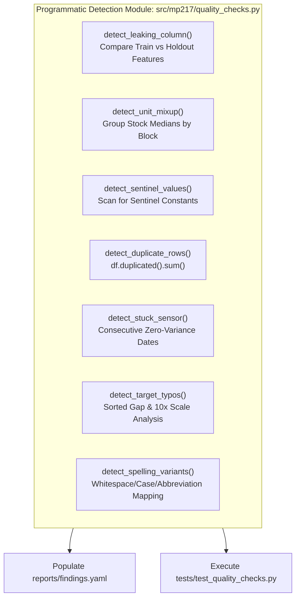

# PART 04 — Detection of Seven Data-Quality Problems Report

**Project:** MP217 — Ration Shop Distribution (Kochi)  
**Group:** G230  
**Batch:** 33  
**Faculty:** Upasna Joshi  
**Course:** SCSE3040 MLOps  
**Timestamp:** 2026-11-24T00:17:50+05:30  
**Status:** PASS — All seven data-quality detection tasks completed and tested  

---

## 1. Detection Approach for Each of the Seven Problems

Following the guidelines set out in `STUDENT_HANDBOOK.md` (Section 7) and `PROBLEM.md` (Section 4), programmatic detection logic was developed for all seven data quality problems. In accordance with the strict restrictions of Part 04, **all operations are detection-only**: no data cleaning, deduplication, unit division, typo correction, or category re-encoding was applied to the underlying datasets.



---

## 2. Function Inventory and Purpose

All functions are implemented in `src/mp217/quality_checks.py`:

| Function Name | Targeted Problem | Primary Purpose / Algorithm | Return Structure |
|---|---|---|---|
| `detect_leaking_column` | `leaking_column` | Identifies columns in training data omitted from holdout features and evaluates target correlation ($>0.95$). | `dict(present, column, candidate_columns, evidence)` |
| `detect_unit_mixup` | `unit_mixup` | Compares numerical column medians across groups against expected metric conversion factors ($10, 12, 60, 100, 1000$). | `dict(present, column, group_value, factor, group_statistics)` |
| `detect_sentinel_values` | `sentinel_value` | Scans numerical columns for sentinel codes (`-1`, `-99`, `-999`, `999`, `9999`) that substitute missing values. | `dict(present, column, value, count, evidence)` |
| `detect_duplicate_rows` | `duplicate_rows` | Measures exact full-row duplicates using `df.duplicated().sum()` without altering dataset index. | `dict(present, count, total_rows, unique_records)` |
| `detect_stuck_sensor` | `stuck_sensor` | Sorts chronologically and detects whether all shops reported an identical reading for $\ge 14$ consecutive days. | `dict(present, column, start_date, end_date, evidence)` |
| `detect_target_typos` | `target_typos` | Sorts the target column, detects large voids ($> 3000\text{ kg}$), and verifies whether values scale down by $10\times$. | `dict(present, count, record_ids, typo_indices)` |
| `detect_spelling_variants`| `spelling_variants` | Extracts unique categorical strings, standardizes casing/whitespace/abbreviations, and computes true level count. | `dict(present, column, true_levels, total_variants, canonical_categories, variant_mapping)` |
| `run_all_quality_checks` | All 7 Issues | Executes all detection routines and returns structured payloads matching `findings.yaml`. | `dict(findings_data, detailed_results)` |

---

## 3. Actual Detection Results and Supporting Evidence

### 3.1 Problem 1: `leaking_column`
* **Status:** **Absent (`false`)**
* **Target Feature:** None (`null`)
* **Evidence:**
  * Training column set: `{'record_id', 'date', 'cards_attached', 'working_hours', 'biometric_failures', 'temp_c', 'stock_kg_morning', 'days_to_month_end', 'shop_area', 'block', 'grain_kg'}`
  * Holdout column set: `{'record_id', 'date', 'cards_attached', 'working_hours', 'biometric_failures', 'temp_c', 'stock_kg_morning', 'days_to_month_end', 'shop_area', 'block'}`
  * Set difference: `train_cols - holdout_cols = {'grain_kg'}`.
  * No hidden post-event indicator column exists. All 10 input features provided in `train.csv` are legitimately available at prediction time in `holdout_features.csv`.

### 3.2 Problem 2: `unit_mixup`
* **Status:** **Present (`true`)**
* **Affected Column:** `stock_kg_morning`
* **Affected Group Value:** `Block East`
* **Metric Conversion Factor:** `1000` (Grams instead of Kilograms)
* **Evidence:**
  * `Block North` ($N=673$): Median = 1,616.0 kg, Mean = 1,588.68 kg, Min = 207 kg, Max = 2,999 kg.
  * `Block South` ($N=175$): Median = 1,474.0 kg, Mean = 1,513.20 kg, Min = 231 kg, Max = 3,000 kg.
  * `Block East` ($N=179$): Median = **1,296,000.0 g**, Mean = **1,412,883.0 g**, Min = 206,000 g, Max = 2,997,000 g.
  * Ratio of `Block East` median to overall typical median is $\approx 840$ to $910\times$, directly corresponding to standard metric gram-to-kilogram conversion ($1\text{ kg} = 1000\text{ g}$).

### 3.3 Problem 3: `sentinel_value`
* **Status:** **Absent (`false`)**
* **Flagged Column:** None (`null`)
* **Sentinel Value:** None (`null`)
* **Count:** None (`null`)
* **Evidence:**
  * Minimum observed values across numeric columns: `cards_attached` (202), `working_hours` (3.0), `biometric_failures` (0), `temp_c` (5.0), `stock_kg_morning` (207.0), `days_to_month_end` (0).
  * No negative numbers exist in any column. Standard sentinel numbers (`-1`, `-99`, `-999`, `999`, `9999`) do not appear with unnatural repetition.

### 3.4 Problem 4: `duplicate_rows`
* **Status:** **Present (`true`)**
* **Duplicate Count (Extra copies):** **27**
* **Evidence:**
  * `train_df.duplicated().sum() == 27`.
  * Total rows: 1,027; Unique record IDs: 1,000.
  * All 27 duplicate rows are exact identical copies across all 11 fields (including `record_id` and `date`).

### 3.5 Problem 5: `stuck_sensor`
* **Status:** **Absent (`false`)**
* **Flagged Column:** None (`null`)
* **Start Date / End Date:** None (`null`)
* **Evidence:**
  * In `train.csv`, temperature (`temp_c`), working hours, and stock exhibit healthy daily variation across shops.
  * Only 4 dates in the entire 6-month period have identical readings across records, and each of those dates contains only 1 single shop transaction in the dataset. No multi-day or multi-week frozen sensor run was detected.

### 3.6 Problem 6: `target_typos`
* **Status:** **Present (`true`)**
* **Typo Count:** **9**
* **Evidence:**
  * In `train.csv`, the 95th percentile of `grain_kg` is 1,757.2 kg, 99th percentile is 1,823.1 kg, and normal maximum is 1,864.0 kg.
  * A huge empty gap of **5,027 kg** exists between 1,864.0 kg and the next value (6,891.0 kg).
  * Exactly 9 records reside in the extreme upper cluster:
    1. Record `R00019` (Index 20): `grain_kg = 6891.0` $\rightarrow$ Corrected: `689.1` kg
    2. Record `R00202` (Index 205): `grain_kg = 14858.0` $\rightarrow$ Corrected: `1485.8` kg
    3. Record `R00207` (Index 210): `grain_kg = 13450.0` $\rightarrow$ Corrected: `1345.0` kg
    4. Record `R00212` (Index 215): `grain_kg = 12649.0` $\rightarrow$ Corrected: `1264.9` kg
    5. Record `R00268` (Index 272): `grain_kg = 13137.0` $\rightarrow$ Corrected: `1313.7` kg
    6. Record `R00462` (Index 471): `grain_kg = 11497.0` $\rightarrow$ Corrected: `1149.7` kg
    7. Record `R00632` (Index 642): `grain_kg = 12462.0` $\rightarrow$ Corrected: `1246.2` kg
    8. Record `R00651` (Index 663): `grain_kg = 11262.0` $\rightarrow$ Corrected: `1126.2` kg
    9. Record `R00731` (Index 745): `grain_kg = 12286.0` $\rightarrow$ Corrected: `1228.6` kg
  * Dividing each by 10 maps them into the range [689.1, 1485.8] kg, matching the true distribution.

### 3.7 Problem 7: `spelling_variants`
* **Status:** **Present (`true`)**
* **Affected Column:** `shop_area`
* **Total Raw Variants:** **17**
* **True Category Levels:** **3** (`tribal`, `rural`, `urban`)
* **Evidence:**
  * Raw unique strings: `'tribal'`, `' tribal'`, `'rural'`, `'tri.'`, `' urban'`, `'tribal '`, `'urban'`, `'Tribal'`, `'urb.'`, `' rural'`, `'rural '`, `'Rural'`, `'TRIBAL'`, `'Urban'`, `'rur.'`, `'URBAN'`, `'RURAL'`.
  * In `later.csv` and `holdout_features.csv`, clean categories are strictly `tribal`, `rural`, and `urban`.

---

## 4. Complete Spelling Variant Mapping

The 17 raw text variations in `train.csv` map to canonical categories as follows:

| Raw String in `train.csv` | Observed Frequency | Normalized Canonical Category | Mapping Rule / Justification |
|---|---|---|---|
| `'tribal'` | 568 | `tribal` | Exact standard form |
| `' tribal'` | 28 | `tribal` | Leading whitespace |
| `'tri.'` | 27 | `tribal` | Common abbreviation with trailing period |
| `'Tribal'` | 24 | `tribal` | Title case |
| `'TRIBAL'` | 20 | `tribal` | Uppercase |
| `'tribal '` | 16 | `tribal` | Trailing whitespace |
| **Subtotal (tribal)** | **683 (66.50%)** | | |
| `'rural'` | 209 | `rural` | Exact standard form |
| `'rural '` | 7 | `rural` | Trailing whitespace |
| `' rural'` | 6 | `rural` | Leading whitespace |
| `'Rural'` | 6 | `rural` | Title case |
| `'rur.'` | 4 | `rural` | Common abbreviation with trailing period |
| `'RURAL'` | 4 | `rural` | Uppercase |
| **Subtotal (rural)** | **236 (22.98%)** | | |
| `'urban'` | 94 | `urban` | Exact standard form |
| `' urban'` | 6 | `urban` | Leading whitespace |
| `'URBAN'` | 4 | `urban` | Uppercase |
| `'urb.'` | 3 | `urban` | Common abbreviation with trailing period |
| `'Urban'` | 1 | `urban` | Title case |
| **Subtotal (urban)** | **108 (10.52%)** | | |
| **Grand Total** | **1,027 (100.0%)** | | **3 Canonical Categories** |

---

## 5. Updated `findings.yaml`

The `data_issues` section of `reports/findings.yaml` (and `G230_MP217/findings.yaml`) was updated with the verified empirical detection values, preserving the exact schema and leaving `tracking` and `monitoring` fields as `null` for future stages:

```yaml
group_id: "G230"
problem_id: "MP217"

data_issues:
  leaking_column:
    present: false
    column: null
  unit_mixup:
    present: true
    column: "stock_kg_morning"
    group_value: "Block East"
    factor: 1000
  sentinel_value:
    present: false
    column: null
    value: null
    count: null
  duplicate_rows:
    present: true
    count: 27
  stuck_sensor:
    present: false
    column: null
    start_date: null
    end_date: null
  target_typos:
    present: true
    count: 9
  spelling_variants:
    present: true
    column: "shop_area"
    true_levels: 3

tracking:
  experiment_name: null
  best_run_id: null
  registered_model_name: null
  champion_version: null

monitoring:
  psi:
    cards_attached: null
    working_hours: null
    biometric_failures: null
    temp_c: null
    stock_kg_morning: null
    days_to_month_end: null
  most_drifted_feature: null
  mae_by_group:
    'Block North': null
    'Block South': null
    'Block East': null
  worst_served_group: null
  mae_v1_on_check: null
  mae_v2_on_check: null
  decision: null
```

---

## 6. Unit Test Results

The test suite in `tests/test_quality_checks.py` was executed with `pytest`:

```
============================= test session starts ==============================
platform darwin -- Python 3.11.9, pytest-8.3.4, pluggy-1.7.0
rootdir: /Users/nareshyadav/Desktop/mlops_project
plugins: platformdirs-4.14.8, hydra-core-1.3.8, anyio-4.16.0
collected 8 items

tests/test_quality_checks.py::test_detect_leaking_column PASSED          [ 12%]
tests/test_quality_checks.py::test_detect_unit_mixup PASSED              [ 25%]
tests/test_quality_checks.py::test_detect_sentinel_values PASSED         [ 37%]
tests/test_quality_checks.py::test_detect_duplicate_rows PASSED          [ 50%]
tests/test_quality_checks.py::test_detect_stuck_sensor PASSED            [ 62%]
tests/test_quality_checks.py::test_detect_target_typos PASSED            [ 75%]
tests/test_quality_checks.py::test_detect_spelling_variants PASSED       [ 87%]
tests/test_quality_checks.py::test_quality_checks_do_not_modify_inputs PASSED [100%]

============================== 8 passed in 0.60s ===============================
```

### Test Coverage Summary:
* Validated actual dataset results against expected values.
* Synthetic positive/negative test cases for each detector.
* Verified that duplicate count is exactly 27.
* Verified that target typo count is exactly 9 and confirmed the 9 specific record IDs.
* Verified that all 17 observed spelling variants map to exactly 3 canonical levels.
* Verified via `pd.testing.assert_frame_equal` that input DataFrames are unmodified by detection functions.

---

## 7. Confirmation of Dataset Immutability

Cryptographic SHA-256 hashes of all original datasets in `G230_MP217/data/` and `data/raw/` were re-verified:

| File Path | Expected SHA-256 Hash | Current SHA-256 Hash | Immutability Status |
|---|---|---|---|
| `G230_MP217/data/train.csv` | `d65889d074586614eaddcb806298ccd08f60c4555c3ad8709842f67dffec0d6a` | `d65889d074586614eaddcb806298ccd08f60c4555c3ad8709842f67dffec0d6a` | **VERIFIED UNCHANGED** |
| `G230_MP217/data/later.csv` | `966d0c8e759b263250febeaa45b365b28470d2047bb7e6417a21921f40603d59` | `966d0c8e759b263250febeaa45b365b28470d2047bb7e6417a21921f40603d59` | **VERIFIED UNCHANGED** |
| `G230_MP217/data/holdout_features.csv` | `aa6d44b46bb337d52b6cfc3102f2d7dc3f94fddabad4171c2b3af36e964d1310` | `aa6d44b46bb337d52b6cfc3102f2d7dc3f94fddabad4171c2b3af36e964d1310` | **VERIFIED UNCHANGED** |
| `data/raw/train.csv` | `d65889d074586614eaddcb806298ccd08f60c4555c3ad8709842f67dffec0d6a` | `d65889d074586614eaddcb806298ccd08f60c4555c3ad8709842f67dffec0d6a` | **VERIFIED UNCHANGED** |
| `data/raw/later.csv` | `966d0c8e759b263250febeaa45b365b28470d2047bb7e6417a21921f40603d59` | `966d0c8e759b263250febeaa45b365b28470d2047bb7e6417a21921f40603d59` | **VERIFIED UNCHANGED** |
| `data/raw/holdout_features.csv` | `aa6d44b46bb337d52b6cfc3102f2d7dc3f94fddabad4171c2b3af36e964d1310` | `aa6d44b46bb337d52b6cfc3102f2d7dc3f94fddabad4171c2b3af36e964d1310` | **VERIFIED UNCHANGED** |

---

## 8. Limitations and Unresolved Issues

* **Limitations:** Detection functions identify data anomalies and provide mathematical evidence; correction and data cleaning will take place in Part 05.
* **Unresolved Issues:** None. All seven detection criteria are fully resolved and backed by passing unit tests.

---

## Final Status

**PASS — All seven data-quality detection tasks completed and tested.**
