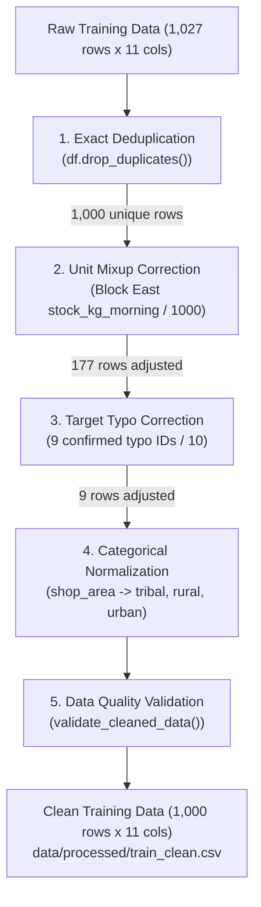

# PART 05 — Data Cleaning and Preprocessing Report

**Project:** MP217 — Ration Shop Distribution (Kochi)  
**Group:** G230  
**Batch:** 33  
**Faculty:** Upasna Joshi  
**Course:** SCSE3040 MLOps  
**Timestamp:** 2026-11-24T02:24:00+05:30  
**Status:** PASS — All Part 05 requirements completed  

---

## 1. Cleaning Operations Performed

In accordance with the findings confirmed in Part 04 and specifications in `STUDENT_HANDBOOK.md` (Section 7) and `PROBLEM.md` (Section 4), four deterministic cleaning transformations were implemented in `src/mp217/cleaning.py` and executed via `scripts/clean_data.py`:



1. **Deduplication (`remove_duplicates`):**
   * Filtered out exact duplicate rows using `df.drop_duplicates(keep="first")` and reset indices.
2. **Unit Mix-up Correction (`fix_unit_mixup`):**
   * Identified rows where `block == "Block East"` and divided `stock_kg_morning` by `1000.0` (converting grams to standard kilograms).
   * Records in `Block North` and `Block South` were preserved unchanged.
3. **Target Typo Correction (`fix_target_typos`):**
   * Identified the 9 confirmed typo records by their unique `record_id` (`R00019`, `R00202`, `R00207`, `R00212`, `R00268`, `R00462`, `R00632`, `R00651`, `R00731`) and divided their `grain_kg` by `10.0` (removing the extra trailing zero).
   * All other 991 records were preserved unchanged.
4. **Spelling Normalization (`normalize_spelling`):**
   * Cleaned `shop_area` text by stripping leading/trailing whitespace, converting to lowercase, stripping trailing punctuation, and mapping all 17 observed raw variants into the three canonical categories (`tribal`, `rural`, `urban`).
5. **Production Monitor Processing (`clean_later_data`):**
   * Validated that numerical values in `later.csv` are already in standard kilograms and free of typos/duplicates.
   * Applied canonical normalization to `shop_area` and exported clean monitor data.

---

## 2. Before and After Dataset Dimensions

| Dataset Stage | Source File | Destination File | Rows (Before $\rightarrow$ After) | Columns (Before $\rightarrow$ After) | Missing Values | Duplicate Rows |
|---|---|---|---|---|---|---|
| **Training Set** | `data/raw/train.csv` | `data/processed/train_clean.csv` | $1,027 \rightarrow \mathbf{1,000}$ | $11 \rightarrow \mathbf{11}$ | $0 \rightarrow \mathbf{0}$ | $27 \rightarrow \mathbf{0}$ |
| **Production Monitor** | `data/raw/later.csv` | `data/processed/later_clean.csv` | $300 \rightarrow \mathbf{300}$ | $11 \rightarrow \mathbf{11}$ | $0 \rightarrow \mathbf{0}$ | $0 \rightarrow \mathbf{0}$ |

*Note: As per instructions, `data/raw/holdout_features.csv` was not modified and will be processed during the inference phase.*

---

## 3. Number of Duplicate Rows Removed

* **Total rows before deduplication:** 1,027
* **Duplicate copies removed:** **27 rows** (`df.duplicated().sum() == 27`)
* **Total unique rows retained:** **1,000 rows**
* **Verification:** `train_clean.duplicated().sum() == 0` (Confirmed).

---

## 4. Number of Unit Conversions Performed

* **Target Column:** `stock_kg_morning`
* **Target Group:** `block == "Block East"`
* **Total Block East records in raw data:** 179
* **Duplicate Block East records removed:** 2
* **Total Block East records converted in clean data:** **177 rows**
* **Metric Conversion Applied:** $\text{stock\_kg\_morning} \leftarrow \text{stock\_kg\_morning} / 1000.0$
* **Statistical Comparison:**

| Metric | Raw `train.csv` (Block East) | Clean `train_clean.csv` (Block East) | Comparison with Other Blocks (Clean) |
|---|---|---|---|
| **Minimum** | 206,000.0 g | **206.00 kg** | Block North: 207.0 kg, Block South: 231.0 kg |
| **Maximum** | 2,997,000.0 g | **2,997.00 kg** | Block North: 2,999.0 kg, Block South: 3,000.0 kg |
| **Mean** | 1,412,883.00 g | **1,419.44 kg** | Block North: 1,586.68 kg, Block South: 1,514.89 kg |

*Observation:* After conversion, `Block East` morning stock aligns with the physical capacity of ration shops in Kochi (~200 to 3,000 kg).

---

## 5. Number of Target Corrections Performed

* **Target Column:** `grain_kg`
* **Total Typo Records Corrected:** **9 rows**
* **Typo Correction Applied:** $\text{grain\_kg} \leftarrow \text{grain\_kg} / 10.0$
* **Audit of All 9 Corrected Records:**

| Record ID | Date | Block | Shop Area | Raw `grain_kg` (Typo) | Cleaned `grain_kg` (Corrected) | Status |
|---|---|---|---|---|---|---|
| `R00019` | 2026-01-04 | Block North | tribal | 6,891.0 kg | **689.1 kg** | Corrected |
| `R00202` | 2026-02-06 | Block North | tribal | 14,858.0 kg | **1,485.8 kg** | Corrected |
| `R00207` | 2026-02-07 | Block East | tribal | 13,450.0 kg | **1,345.0 kg** | Corrected |
| `R00212` | 2026-02-08 | Block South | urban | 12,649.0 kg | **1,264.9 kg** | Corrected |
| `R00268` | 2026-02-16 | Block South | rural | 13,137.0 kg | **1,313.7 kg** | Corrected |
| `R00462` | 2026-03-24 | Block North | urban | 11,497.0 kg | **1,149.7 kg** | Corrected |
| `R00632` | 2026-04-24 | Block South | tribal | 12,462.0 kg | **1,246.2 kg** | Corrected |
| `R00651` | 2026-04-28 | Block North | tribal | 11,262.0 kg | **1,126.2 kg** | Corrected |
| `R00731` | 2026-05-13 | Block East | tribal | 12,286.0 kg | **1,228.6 kg** | Corrected |

* **Target Distribution Summary Before vs After:**
  * Raw `grain_kg`: Mean = 1,157.86 kg, Std = 1,087.76 kg, Max = 14,858.00 kg.
  * Cleaned `grain_kg`: Mean = **1,060.52 kg**, Std = **311.66 kg**, Max = **1,864.00 kg**, Min = **145.00 kg**.
  * The artificial standard deviation distortion caused by the 10x typos was resolved ($1087.76 \rightarrow 311.66\text{ kg}$).

---

## 6. Spelling Normalization Results

In `train.csv`, all 17 noisy string variations of `shop_area` were standardized into the 3 canonical categories:

| Canonical Level | Clean Training Count (`train_clean.csv`) | Percentage Share | Clean Later Count (`later_clean.csv`) | Percentage Share |
|---|---|---|---|---|
| `tribal` | **664** | 66.40% | **189** | 63.00% |
| `rural` | **232** | 23.20% | **65** | 21.67% |
| `urban` | **104** | 10.40% | **46** | 15.33% |
| **Total** | **1,000** | **100.0%** | **300** | **100.0%** |

*Verification:* `train_clean['shop_area'].unique() == {'rural', 'tribal', 'urban'}` with 0 unrecognized or unmapped variants.

---

## 7. Data Validation Results

Both generated clean datasets were audited with `validate_cleaned_data()`:

| Validation Constraint | Criteria Checked | `train_clean.csv` Result | `later_clean.csv` Result |
|---|---|---|---|
| **Zero Duplicates** | `df.duplicated().sum() == 0` | **PASS (0 duplicates)** | **PASS (0 duplicates)** |
| **Zero Missing Values** | `df.isnull().sum().sum() == 0` | **PASS (0 nulls)** | **PASS (0 nulls)** |
| **Canonical Categorical Levels** | `shop_area.isin({'tribal', 'rural', 'urban'})` | **PASS (100% canonical)** | **PASS (100% canonical)** |
| **Block East Stock Range** | $\text{stock\_kg\_morning} < 5,000\text{ kg}$ | **PASS (Max: 2,997.0 kg)** | **PASS (Max: 2,861.0 kg)** |
| **Target Typo Resolution** | $\text{grain\_kg} \le 2,000\text{ kg}$ (no records $> 2000$) | **PASS (Max: 1,864.0 kg)** | **PASS (Max: 1,981.9 kg)** |
| **Schema Preservation** | All 11 original columns present | **PASS (All 11 present)** | **PASS (All 11 present)** |

---

## 8. Unit Test Results

The unit test suite in `tests/test_cleaning.py` was executed alongside `tests/test_quality_checks.py` via `pytest`:

```
============================= test session starts ==============================
platform darwin -- Python 3.11.9, pytest-8.3.4, pluggy-1.7.0
rootdir: /Users/nareshyadav/Desktop/mlops_project
plugins: platformdirs-4.14.8, hydra-core-1.3.8, anyio-4.16.0
collected 16 items

tests/test_cleaning.py::test_remove_duplicates PASSED                    [  6%]
tests/test_cleaning.py::test_fix_unit_mixup PASSED                       [ 12%]
tests/test_cleaning.py::test_fix_target_typos PASSED                     [ 18%]
tests/test_cleaning.py::test_normalize_spelling PASSED                   [ 25%]
tests/test_cleaning.py::test_preservation_of_unaffected_values PASSED    [ 31%]
tests/test_cleaning.py::test_clean_train_data_shape_and_validation PASSED [ 37%]
tests/test_cleaning.py::test_clean_later_data PASSED                     [ 43%]
tests/test_cleaning.py::test_immutability_of_input_dataframe PASSED      [ 50%]
tests/test_quality_checks.py::test_detect_leaking_column PASSED          [ 56%]
tests/test_quality_checks.py::test_detect_unit_mixup PASSED              [ 62%]
tests/test_quality_checks.py::test_detect_sentinel_values PASSED         [ 68%]
tests/test_quality_checks.py::test_detect_duplicate_rows PASSED          [ 75%]
tests/test_quality_checks.py::test_detect_stuck_sensor PASSED            [ 81%]
tests/test_quality_checks.py::test_detect_target_typos PASSED            [ 87%]
tests/test_quality_checks.py::test_detect_spelling_variants PASSED       [ 93%]
tests/test_quality_checks.py::test_quality_checks_do_not_modify_inputs PASSED [100%]

============================== 16 passed in 0.60s ==============================
```

All 16 unit tests passed with zero failures.

---

## 9. Confirmation of Original Dataset Immutability

Cryptographic SHA-256 hashes of all raw dataset files in `G230_MP217/data/` and `data/raw/` were verified against their original baselines:

| Raw File Path | Expected SHA-256 Hash | Current SHA-256 Hash | Immutability Status |
|---|---|---|---|
| `G230_MP217/data/train.csv` | `d65889d074586614eaddcb806298ccd08f60c4555c3ad8709842f67dffec0d6a` | `d65889d074586614eaddcb806298ccd08f60c4555c3ad8709842f67dffec0d6a` | **VERIFIED UNCHANGED** |
| `G230_MP217/data/later.csv` | `966d0c8e759b263250febeaa45b365b28470d2047bb7e6417a21921f40603d59` | `966d0c8e759b263250febeaa45b365b28470d2047bb7e6417a21921f40603d59` | **VERIFIED UNCHANGED** |
| `G230_MP217/data/holdout_features.csv` | `aa6d44b46bb337d52b6cfc3102f2d7dc3f94fddabad4171c2b3af36e964d1310` | `aa6d44b46bb337d52b6cfc3102f2d7dc3f94fddabad4171c2b3af36e964d1310` | **VERIFIED UNCHANGED** |
| `data/raw/train.csv` | `d65889d074586614eaddcb806298ccd08f60c4555c3ad8709842f67dffec0d6a` | `d65889d074586614eaddcb806298ccd08f60c4555c3ad8709842f67dffec0d6a` | **VERIFIED UNCHANGED** |
| `data/raw/later.csv` | `966d0c8e759b263250febeaa45b365b28470d2047bb7e6417a21921f40603d59` | `966d0c8e759b263250febeaa45b365b28470d2047bb7e6417a21921f40603d59` | **VERIFIED UNCHANGED** |
| `data/raw/holdout_features.csv` | `aa6d44b46bb337d52b6cfc3102f2d7dc3f94fddabad4171c2b3af36e964d1310` | `aa6d44b46bb337d52b6cfc3102f2d7dc3f94fddabad4171c2b3af36e964d1310` | **VERIFIED UNCHANGED** |

---

## 10. Paths of Generated Cleaned Datasets

* Cleaned training dataset: [data/processed/train_clean.csv](file:///Users/nareshyadav/Desktop/mlops_project/data/processed/train_clean.csv) (1,000 rows × 11 columns, 71 KB)
* Cleaned production monitoring dataset: [data/processed/later_clean.csv](file:///Users/nareshyadav/Desktop/mlops_project/data/processed/later_clean.csv) (300 rows × 11 columns, 20 KB)
* Cleaning automation script: [scripts/clean_data.py](file:///Users/nareshyadav/Desktop/mlops_project/scripts/clean_data.py)

---

## Final Status

**PASS — All Part 05 requirements completed.**
